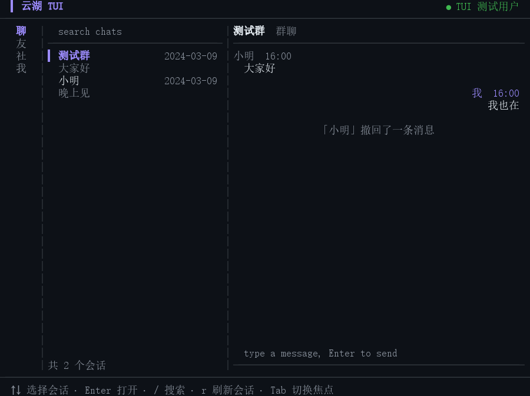
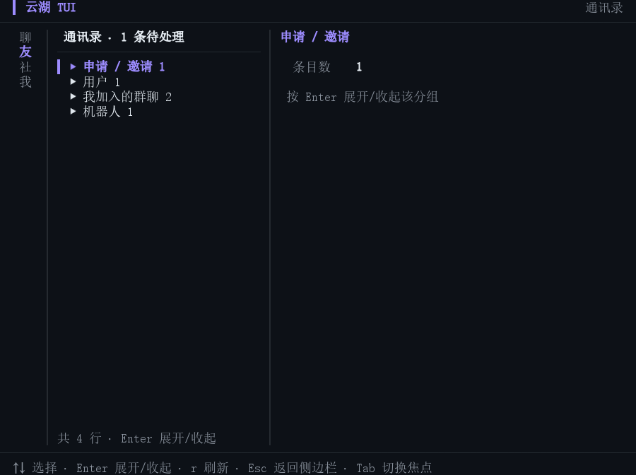
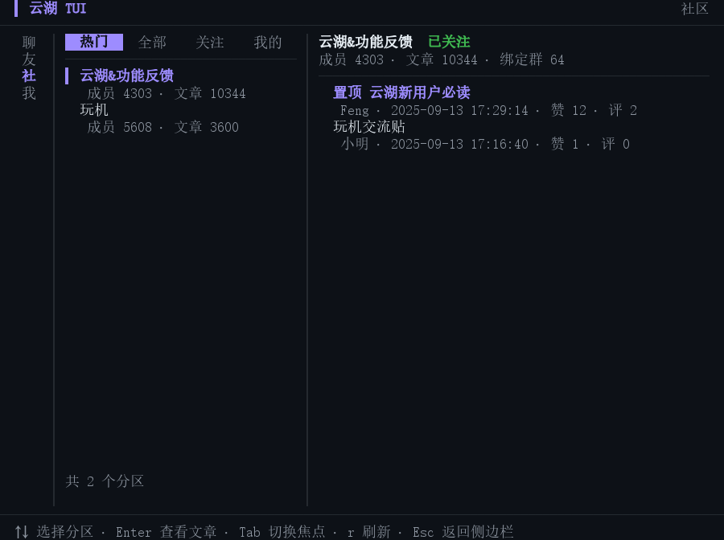
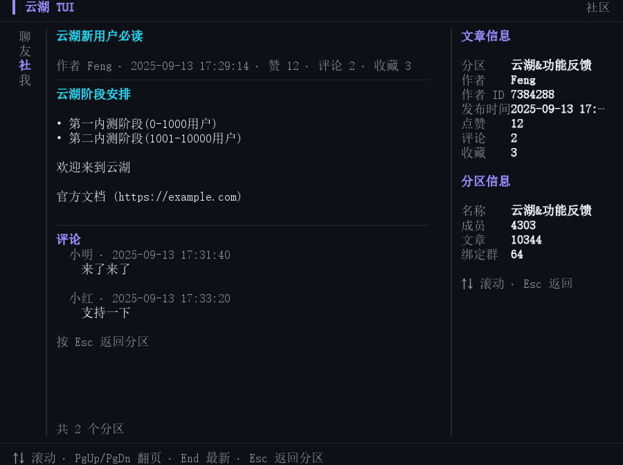
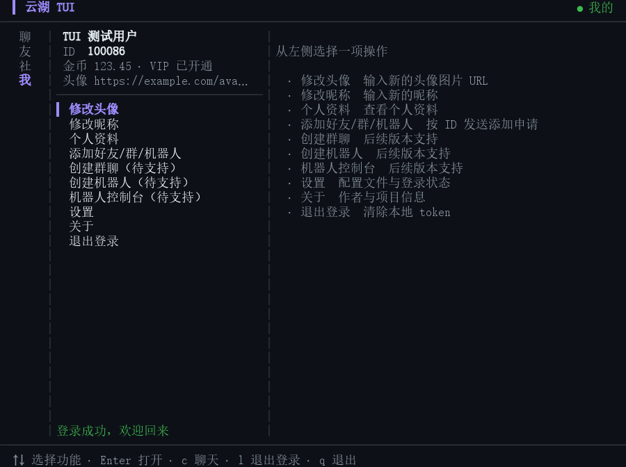
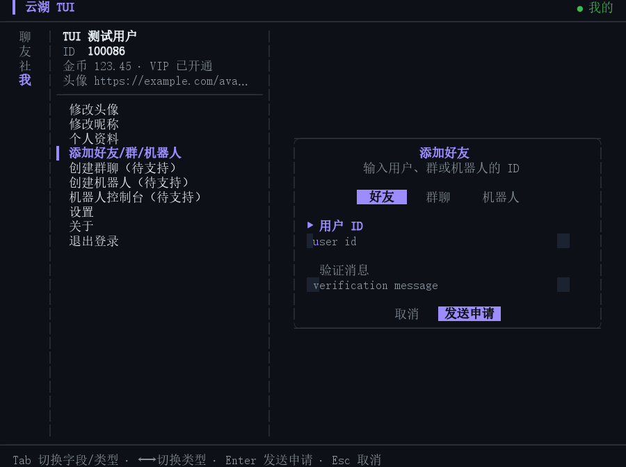
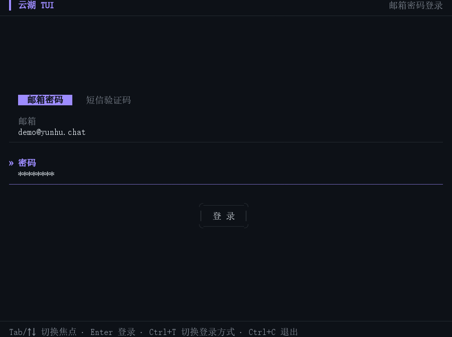

# 云湖 TUI 客户端（yhchat-tui）

一个用 Go + [Bubble Tea](https://github.com/charmbracelet/bubbletea) 编写的云湖（Yunhu）社交平台命令行客户端，支持 **Windows**、**macOS** 与 **Linux**。
当前版本已实现**登录**、**主窗口（会话列表 + 消息历史 + 发送文本）**、**通讯录**、**社区浏览**与**个人页面**；
WebSocket 实时收发、社区互动与通讯录申请处理放到下一阶段。

> 本项目是非官方客户端，API 依据公开文档仓库 [`yhchatAPI`](../yhchatAPI) 实现，仅供学习交流。

## 功能

- **邮箱密码登录**：`POST /v1/user/email-login`
- **短信验证码登录**：获取并**在终端内直接渲染图形验证码**（24 位真彩色半块字符），发送短信、验证登录
  - `Ctrl+R` 更换图形验证码，`Ctrl+S` 把验证码图片保存为 PNG（终端看不清时可用图片查看器打开）
- **登录状态持久化 / 自动登录**：token 保存在本机配置目录，下次启动自动校验并进入主窗口
- **主窗口（仿官方客户端三栏布局）**：左侧栏（聊天 / 通讯录 / 社区 / 我的）+ 会话搜索 + 会话列表（未读、@、最后消息、时间）+ 聊天区（会话信息、消息历史、输入框发送文本）
  - **WebSocket 实时消息**：新消息/编辑/撤回/流式消息实时更新会话列表与聊天窗口；断线自动重连并重新同步；头部显示 `● 实时` / `○ 重连中`
  - **历史分页**：消息区滚动到顶部后继续上翻自动加载更早消息，自动保持阅读位置
  - **已读状态**：打开会话自动清除未读并调用 `dismiss-notification`
  - 文本消息发送（`Enter`）、会话本地过滤、`r` 刷新会话、消息区滚动/翻页
  - 支持渲染文本 / Markdown / 图片 / 文件 / 语音 / 视频 / 文章卡片 / 表情 / HTML / 卡片消息（占位信息 + 文件/图片 URL、大小、时长等）；引用消息与提示信息
  - 自己的消息右对齐、他人消息左对齐、撤回消息居中提示；`x` 撤回自己最后一条消息
- **通讯录**：申请/邀请、好友、我加入的群聊、机器人分组（可展开/收起）；未展开的分组右侧不显示内容，选中条目后显示该条目主页（ID、类型、群内身份/免打扰等），底部「进入聊天」按钮可直接打开会话
- **社区**：分区列表（热门 / 全部 / 关注 / 我的四个分类）、分区文章列表、文章详情（Markdown 内容 + 评论 + 分区/作者信息侧栏）
- **我的（个人页面）**：个人卡片（昵称/ID/金币/VIP/头像）+ 菜单：修改头像、修改昵称、个人资料、添加好友/群/机器人、创建群聊、创建机器人、机器人控制台、开发文档、设置、关于我们、退出登录
  - 已实现：修改昵称、修改头像（URL）、查看个人资料、添加好友（居中对话框：好友/群聊/机器人类型切换 + ID + 验证消息）、设置、关于（作者/项目地址）、退出登录；创建群聊/机器人等暂为占位页
- **退出登录**：调用 `POST /v1/user/logout` 并清除本地 token
- **跨平台**：纯 Go、无 CGO；Windows（386/amd64/arm64）、macOS（amd64/arm64）、Linux（amd64/arm64/386/armv6/armv7/loong64/riscv64）
- **全终端界面**：顶部标题栏 + 内容区 + **最底部快捷键提示栏**，不使用浮动卡片；小终端自动收紧间距（建议 ≥24 行）

## 界面预览

以下截图由 TUI 实际渲染的 ANSI 输出转换而成（字体/配色会因终端而略有差异）。



| 通讯录（分组 + 详情） | 社区（分区 + 文章列表） |
| --- | --- |
|  |  |

| 社区文章详情（Markdown + 评论 + 侧栏） | 我的（个人页面） |
| --- | --- |
|  |  |



| 邮箱密码登录 | 短信验证码登录（终端内渲染图片验证码） |
| --- | --- |
|  |  |

| 登录失败提示 |
| --- |
|  |

## 环境要求

- Go **1.24+**（开发使用 go1.27.4 验证）
- 任意支持 ANSI 转义序列的终端：Windows Terminal、cmd/PowerShell 窗口、Linux 常见终端均可
- 已执行 `go mod vendor`，**离线即可构建**（无需访问 Go 模块代理）

## 构建

### 全量构建（推荐）

一条命令完成：代码检查（gofmt / go vet）→ 测试 → Windows / macOS / Linux 全架构交叉编译，
并为每个目标注入版本 / commit / 构建时间。**产物只有各平台的可执行文件，不做打包。**

```powershell
# Windows（PowerShell 7 或 Windows PowerShell 5.1）
pwsh -File scripts\build.ps1
```

```bash
# Linux / macOS / Git Bash
./scripts/build.sh
```

两个入口只是薄封装，真正的构建逻辑在 [`tools/build`](tools/build/main.go) 中，
因此 Windows 与 Linux 产物完全一致，且不依赖外部 `zip` / `tar` / `sha256sum` 工具。

常用参数（两个脚本一致，用 `-help` 查看全部）：

| 参数 | 说明 |
| --- | --- |
| `-version <版本>` | 指定版本号（默认取 git tag，否则 `0.1.0-dev+<commit>`） |
| `-out <目录>` | 输出目录（默认仓库下 `dist/`） |
| `-targets <列表>` | 目标列表，逗号分隔，如 `windows/amd64,linux/amd64` |
| `-skip-checks` | 跳过 gofmt / go vet |
| `-skip-tests` | 跳过 go test |
| `-no-clean` | 构建前不清空输出目录 |

默认目标（12 个）：

| 系统 | 架构 |
| --- | --- |
| Windows | 386、amd64、arm64 |
| macOS | amd64、arm64 |
| Linux | 386、amd64、armv6、armv7、arm64、loong64、riscv64 |

产物示例（`dist/`，只有可执行文件）：

```
dist/
├── yhchat-tui-windows-386.exe / -amd64.exe / -arm64.exe
├── yhchat-tui-darwin-amd64 / -arm64
└── yhchat-tui-linux-386 / -amd64 / -armv6 / -armv7 / -arm64 / -loong64 / -riscv64
```

### 单平台构建

```bash
go build -o yhchat-tui .
yhchat-tui -version      # 单独构建显示 0.1.0-dev，全量构建会注入实际版本信息
```

## 运行

```bash
./yhchat-tui            # Windows: yhchat-tui.exe
```

首次启动进入登录页：

- `Tab` / `↑` / `↓`：切换输入框
- `Ctrl+T`：把焦点移到顶部的登录方式标签（再用 `←` / `→` 切换邮箱登录 / 短信登录）
- `Enter`：执行当前步骤（登录、获取图形验证码、发送短信验证码）
- `Ctrl+C`：退出
- 登录成功后进入**主窗口**（完整快捷键在底部提示栏），左侧栏可在四个页面间切换：

| 页面 | 快捷键 |
| --- | --- |
| 侧边栏 | `↑↓` 选择「聊 / 友 / 社 / 我」· `Enter` 进入 · `Tab` 切换焦点 |
| 聊天 | 搜索框 `Enter` 过滤；会话列表 `↑↓` 选择、`Enter` 打开并聚焦输入框、`/` 搜索、`r` 刷新；消息区 `↑↓`/`PgUp/PgDn`/`End` 滚动、顶部继续 `↑` 加载更早消息、`x` 撤回自己最后一条，`Esc` 返回；输入框 `Enter` 发送、`Esc` 返回消息区 |
| 通讯录 | `↑↓` 选择、`Enter` 展开/收起分组（选中条目时 `Enter` 进入聊天）、`r` 刷新、`Esc` 返回侧边栏、`Tab` 切换焦点 |
| 社区 | `←→` 切换分类（热门/全部/关注/我的）、`↑↓` 选择分区/文章、`Enter` 查看文章、`Esc` 逐级返回 |
| 我的 | `↑↓` 选择功能、`Enter` 打开、表单内 `Tab`/`↑↓` 切换字段（添加好友用 `←→` 切换类型）、`Enter` 提交、`Esc` 返回；`c` 聊天、`l` 退出登录、`q` 退出 |

### 短信登录流程

1. 切换到「短信验证码」标签，程序自动获取图形验证码
2. 在终端中查看图片并输入其中的字符（`Ctrl+S` 可保存 PNG、`Ctrl+R` 可换一张）
3. `Enter` 发送短信验证码
4. 输入收到的短信验证码，`Enter` 登录

### 命令行参数

```
yhchat-tui [-config FILE] [-server URL] [-version]

  -config FILE   指定配置文件路径（默认 ~/.yhchat-tui/config.json）
  -server URL    指定 API 服务器地址（默认 https://chat-go.jwzhd.com，调试用）
  -version       打印版本号
```

## 配置文件

配置文件固定放在**用户主文件夹**下的隐藏目录：

| 平台 | 位置 |
| --- | --- |
| Windows | `%USERPROFILE%\.yhchat-tui\config.json`（如 `C:\Users\Admin\.yhchat-tui\config.json`） |
| Linux / macOS | `~/.yhchat-tui/config.json` |

- 旧版本位置（`%AppData%\yhchat-tui\config.json` / `$XDG_CONFIG_HOME/yhchat-tui/config.json`）
  中的配置会在首次启动时自动迁移到新位置。
- 文件权限 `0600`（Windows 由用户目录 ACL 保护）
- 保存登录 token、设备 ID（`deviceId`，登录设备标识）、上次登录方式与邮箱；短信手机号只以掩码形式保存（如 `138****1234`），登录页仅作为占位提示，不回填明文
- token 不会出现在界面或日志中；如需退出登录请使用「我的」页面的 `l`，或删除该文件


## 测试

```bash
go test ./...        # 单元测试 + 登录流程集成测试（使用本地 mock HTTP 服务）
go vet ./...
```

测试覆盖：

- API 客户端：邮箱/短信登录、图文验证码、protobuf 用户信息解析、未登录判定、错误路径
- protobuf 解码：真实抓包 fixture、未知字段、截断/随机字节不 panic
- 验证码渲染：真实图片 fixture、尺寸预算、彩色/灰度两条路径
- 配置读写：设备 ID 生成、原子写入、损坏配置备份
- TUI：完整邮箱/短信登录流程、自动登录、过期、退出、表单校验、快捷键、多终端尺寸布局（测试内置 httptest mock 服务，不访问真实云湖）
- 主窗口：会话列表加载、会话切换与消息加载、发送消息/失败回填、搜索过滤、侧边栏切换、焦点循环、会话过期回登录
- 聊天实时能力：WebSocket 帧编解码与本地假服务器集成测试、push/edit/recall/stream 事件处理与去重、历史分页、已读上报、撤回请求、重连状态
- 通讯录/社区/我的：分组展开与详情、分区/文章加载与详情、文章 Markdown 渲染与评论、侧边栏页面切换、昵称/头像修改、添加好友申请、个人资料加载
- `internal/tui/testdata/snapshots/` 保存了各页面在纯文本下的渲染快照（`UPDATE_SNAPSHOTS=1 go test ./internal/tui` 可更新）

## 项目结构

```
main.go                    命令行入口（参数解析、tea 程序启动）
internal/api/              云湖 HTTP API 客户端（登录 / 会话 / 消息 / 通讯录 / 社区 / 个人资料）
                           + 手写 RFC6455 WebSocket 客户端（实时消息、心跳、重连）
internal/config/           token / 设备 ID 持久化（~/.yhchat-tui/config.json）
internal/tui/              登录页、聊天、通讯录、社区、我的、侧边栏 shell、样式与快照测试
internal/captchaimg/       图形验证码 → 终端 ANSI 半块字符渲染
internal/captchaimg/testdata/captcha.png   真实验证码测试图
tools/build/               跨平台全量构建器（检查、测试、交叉编译，只产出可执行文件）
docs/API_NOTES.md          本项目实际调用的 API 实测记录
docs/VERIFICATION.md       独立验收报告（构建 / API 契约 / 安全 / TUI 检查，结论 PASS）
scripts/build.ps1          全量构建入口（Windows / PowerShell）
scripts/build.sh           全量构建入口（Linux / macOS / Git Bash）
scripts/env.ps1            沙箱开发环境变量（仅开发会话需要）
vendor/                    依赖（离线构建）
```

## 已知限制

- **社区目前是只读浏览**：不支持发文章/评论/点赞/收藏；通讯录不支持处理申请/删除好友
- **创建群聊 / 创建机器人 / 机器人控制台**为占位页，暂未实现
- 发送仅支持**文本消息**，暂不支持发送图片/文件/语音、引用回复、编辑消息（可撤回自己最后一条）
- 消息中的图片/文件/语音/视频只展示占位信息与 URL，不直接下载/播放
- 会话列表暂不支持分组/置顶；消息按页加载（每页 30 条）
- 建议终端高度 ≥ 24 行；更小的窗口会自动收紧间距，极端尺寸下内容可能超出屏幕（不会崩溃）
- 短信登录使用**图文验证码**；文档中另有滑动验证码（`slide`），TUI 内难以交互，暂未支持
- 终端图片渲染需要 24 位真彩色；`NO_COLOR=1` 或 `TERM=dumb` 时自动降级为灰度字符画，可读性有限（此时建议 `Ctrl+S` 保存图片）
- 登录接口对平台参数只做记录，客户端按运行系统自动填写 `windows` / `linux`
- 账号密码只在本地用于登录请求，不会被保存；token 保存于本机配置目录；短信手机号仅以掩码（`138****1234`）形式保存与显示，已有明文配置会在启动时自动脱敏

## 免责声明

本项目为第三方非官方实现，与云湖官方无关。API 属于公开文档记录的接口，可能随时变更；
请勿将本项目用于违反服务条款的用途，并妥善保管自己的账号凭据与 token。


