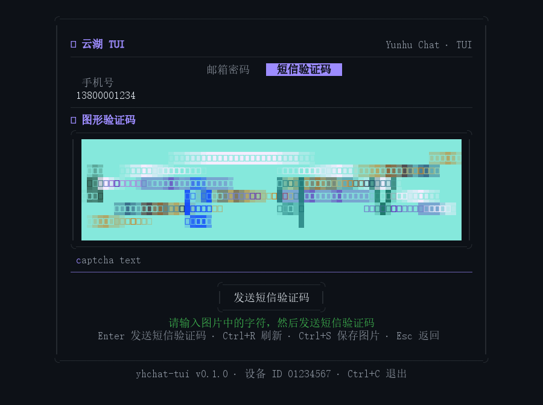
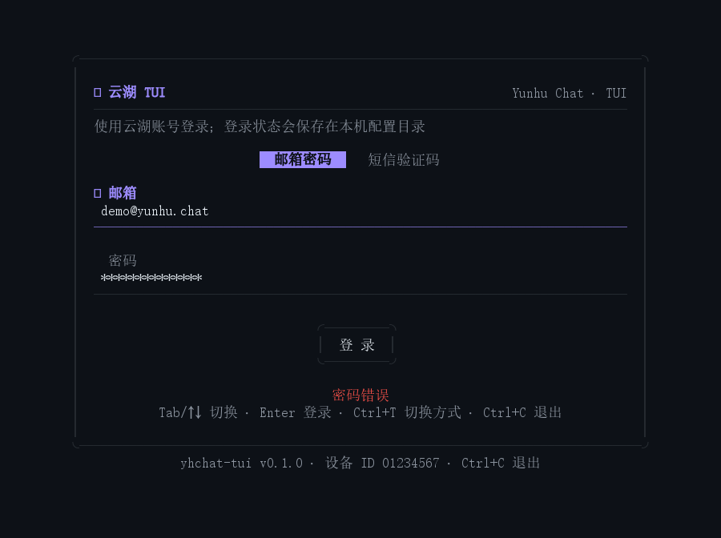
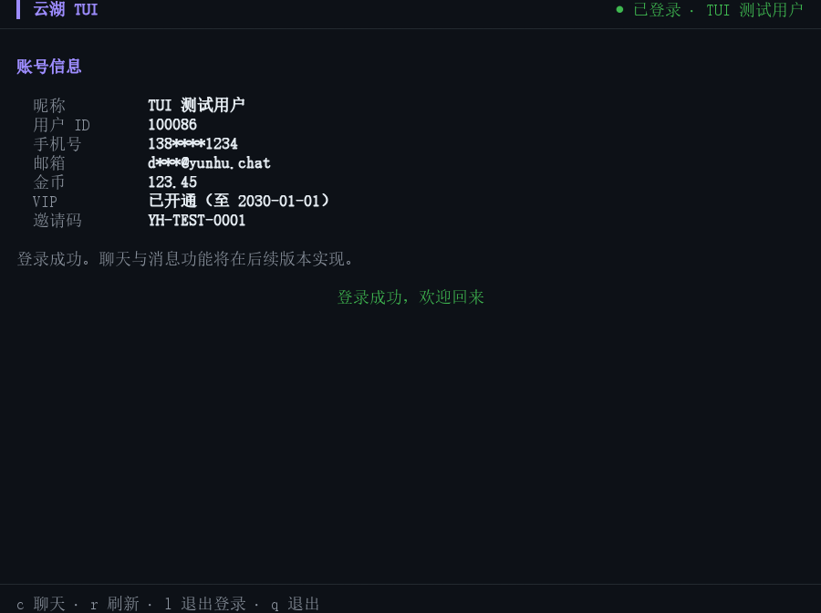

# 云湖 TUI 客户端（yhchat-tui）

一个用 Go + [Bubble Tea](https://github.com/charmbracelet/bubbletea) 编写的云湖（Yunhu）社交平台命令行客户端，支持 **Windows** 和 **Linux**。
当前版本已实现**登录**、**主窗口（会话列表 + 消息历史 + 发送文本）**与**账号信息页**；
WebSocket 实时收发放到下一阶段（当前需手动刷新）。

> 本项目是非官方客户端，API 依据公开文档仓库 [`yhchatAPI`](../yhchatAPI) 实现，仅供学习交流。

## 功能

- **邮箱密码登录**：`POST /v1/user/email-login`
- **短信验证码登录**：获取并**在终端内直接渲染图形验证码**（24 位真彩色半块字符），发送短信、验证登录
  - `Ctrl+R` 更换图形验证码，`Ctrl+S` 把验证码图片保存为 PNG（终端看不清时可用图片查看器打开）
- **登录状态持久化 / 自动登录**：token 保存在本机配置目录，下次启动自动校验并进入主窗口
- **主窗口（仿官方客户端三栏布局）**：左侧栏（聊天 / 我的）+ 会话搜索 + 会话列表（未读、@、最后消息、时间）+ 聊天区（会话信息、消息历史、输入框发送文本）
  - 文本消息发送（`Enter`）、消息历史加载、会话本地过滤、`r` 刷新会话、消息区滚动/翻页
  - 自己的消息右对齐、他人消息左对齐、撤回消息居中提示
- **账号信息页**：昵称、用户 ID、脱敏手机号/邮箱、金币、VIP 状态、邀请码
- **退出登录**：调用 `POST /v1/user/logout` 并清除本地 token
- **跨平台**：纯 Go、无 CGO；Windows / Linux（amd64、arm64）
- **全终端界面**：顶部标题栏 + 内容区 + **最底部快捷键提示栏**，不使用浮动卡片；小终端自动收紧间距（建议 ≥24 行）

## 界面预览

以下截图由 TUI 实际渲染的 ANSI 输出转换而成（字体/配色会因终端而略有差异）。


| 邮箱密码登录 | 短信验证码登录（终端内渲染图片验证码） |
| --- | --- |
|  |  |

| 登录失败提示 | 账号信息页（侧边栏「我的」） |
| --- | --- |
|  |  |

## 环境要求

- Go **1.24+**（开发使用 go1.27.4 验证）
- 任意支持 ANSI 转义序列的终端：Windows Terminal、cmd/PowerShell 窗口、Linux 常见终端均可
- 已执行 `go mod vendor`，**离线即可构建**（无需访问 Go 模块代理）

## 构建

### 全量构建（推荐）

一条命令完成：代码检查（gofmt / go vet）→ 测试 → Windows / Linux 全架构交叉编译 → 注入版本信息 → 打包 → 校验和。

```powershell
# Windows（PowerShell 7 或 Windows PowerShell 5.1）
pwsh -File scripts\build.ps1
```

```bash
# Linux / macOS / Git Bash
./scripts/build.sh
```

两个入口只是薄封装，真正的构建逻辑在跨平台的 Go 构建器 [`tools/build`](tools/build/main.go) 中，
因此 Windows 与 Linux 产物完全一致，且不依赖外部 `zip` / `tar` / `sha256sum` 工具。

常用参数（两个脚本一致，用 `-help` 查看全部）：

| 参数 | 说明 |
| --- | --- |
| `-version <版本>` | 指定版本号（默认取 git tag，否则 `0.1.0-dev+<commit>`） |
| `-out <目录>` | 输出目录（默认仓库下 `dist/`） |
| `-targets <列表>` | 目标列表，逗号分隔，如 `windows/amd64,linux/amd64` |
| `-skip-checks` | 跳过 gofmt / go vet |
| `-skip-tests` | 跳过 go test |
| `-no-archive` | 只生成可执行文件，不打包 |
| `-no-clean` | 构建前不清空输出目录 |

默认目标（9 个）：

| 系统 | 架构 |
| --- | --- |
| Windows | 386、amd64、arm64 |
| Linux | 386、amd64、arm(v7)、arm64、loong64、riscv64 |

产物示例（`dist/`）：

```
dist/
├── yhchat-tui-windows-386.exe / -amd64.exe / -arm64.exe
├── yhchat-tui-linux-386 / -amd64 / -arm / -arm64 / -loong64 / -riscv64
├── yhchat-tui-<版本>-windows-amd64.zip          # 每个平台的 release 包（含 README）
├── yhchat-tui-<版本>-linux-amd64.tar.gz
├── SHA256SUMS.txt                               # 所有产物的 SHA-256
└── BUILD-INFO.txt                               # 版本 / commit / 构建时间 / 目标清单
```

### 单平台构建

```bash
go build -o yhchat-tui .
yhchat-tui -version      # 单独构建显示 0.1.0-dev，全量构建会注入实际版本信息
```

## 运行

```bash
./yhchat-tui            # Windows: yhchat-tui.exe
```

首次启动进入登录页：

- `Tab` / `↑` / `↓`：切换输入框
- `Ctrl+T`：把焦点移到顶部的登录方式标签（再用 `←` / `→` 切换邮箱登录 / 短信登录）
- `Enter`：执行当前步骤（登录、获取图形验证码、发送短信验证码）
- `Ctrl+C`：退出
- 登录成功后进入**主窗口**（完整快捷键在底部提示栏）：

| 焦点 | 快捷键 |
| --- | --- |
| 侧边栏 | `↑↓` 选择「聊 / 我」· `Enter` 进入 · `Tab` 切换焦点 |
| 搜索框 | 输入关键词过滤会话 · `Enter` 跳到列表 · `Esc` 清空 |
| 会话列表 | `↑↓` 选择会话（自动加载最近消息）· `Enter` 打开并聚焦输入框 · `/` 搜索 · `r` 刷新 |
| 消息区 | `↑↓` 滚动 · `PgUp/PgDn` 翻页 · `End` 跳到最新 · `Esc` 返回列表 |
| 输入框 | 输入文本 · `Enter` 发送 · `Esc` 返回消息区 |

- 侧边栏选择「我」进入账号信息页：`c` 返回聊天，`r` 刷新账号信息，`l` 退出登录，`q` 退出

### 短信登录流程

1. 切换到「短信验证码」标签，程序自动获取图形验证码
2. 在终端中查看图片并输入其中的字符（`Ctrl+S` 可保存 PNG、`Ctrl+R` 可换一张）
3. `Enter` 发送短信验证码
4. 输入收到的短信验证码，`Enter` 登录

### 命令行参数

```
yhchat-tui [-config FILE] [-server URL] [-version]

  -config FILE   指定配置文件路径（默认使用用户配置目录）
  -server URL    指定 API 服务器地址（默认 https://chat-go.jwzhd.com，调试用）
  -version       打印版本号
```

## 配置文件

| 平台 | 位置 |
| --- | --- |
| Windows | `%AppData%\yhchat-tui\config.json` |
| Linux | `$XDG_CONFIG_HOME/yhchat-tui/config.json`（默认 `~/.config/yhchat-tui/config.json`） |

- 文件权限 `0600`（Windows 由用户目录 ACL 保护）
- 保存登录 token、设备 ID（`deviceId`，登录设备标识）和上次使用的邮箱/手机号
- token 不会出现在界面或日志中；如需退出登录请使用主页的 `l`，或删除该文件

## 无账号体验 / 联调

仓库内含一个本地 mock API，可在没有云湖账号时体验完整登录流程：

```bash
# 终端 1：启动 mock 服务（监听 127.0.0.1:18080）
go run ./tools/mockapi

# 终端 2：让 TUI 指向 mock 服务
go run . -server http://127.0.0.1:18080 -config ./demo-config.json
```

mock 账号：

- 邮箱登录：`demo@yunhu.chat` / `demo1234`
- 短信登录：任意 11 位手机号，短信验证码 `123456`；图形验证码内容任意填写即可
- 主窗口自带 4 个演示会话与历史消息，`Enter` 打开会话、在输入框发送消息都会写入 mock 内存（重启 mock 后重置）

## 测试

```bash
go test ./...        # 单元测试 + 登录流程集成测试（使用本地 mock HTTP 服务）
go vet ./...
```

测试覆盖：

- API 客户端：邮箱/短信登录、图文验证码、protobuf 用户信息解析、未登录判定、错误路径
- protobuf 解码：真实抓包 fixture、未知字段、截断/随机字节不 panic
- 验证码渲染：真实图片 fixture、尺寸预算、彩色/灰度两条路径
- 配置读写：设备 ID 生成、原子写入、损坏配置备份
- TUI：完整邮箱/短信登录流程、自动登录、过期、退出、表单校验、快捷键、多终端尺寸布局
- 主窗口：会话列表加载、会话切换与消息加载、发送消息/失败回填、搜索过滤、侧边栏切换、焦点循环、会话过期回登录
- `internal/tui/testdata/snapshots/` 保存了各页面在纯文本下的渲染快照（`UPDATE_SNAPSHOTS=1 go test ./internal/tui` 可更新）

## 项目结构

```
main.go                    命令行入口（参数解析、tea 程序启动）
internal/api/              云湖 HTTP API 客户端（登录 / 会话 / 消息）+ protobuf 解码
internal/config/           token / 设备 ID 持久化
internal/tui/              登录页、主窗口（会话+聊天）、账号页、根模型、样式
internal/captchaimg/       图形验证码 → 终端 ANSI 半块字符渲染
internal/captchaimg/testdata/captcha.png   真实验证码测试图
tools/mockapi/             本地 mock API（登录 / 会话列表 / 消息历史 / 发送，演示可玩主窗口）
tools/build/               跨平台全量构建器（检查、测试、交叉编译、打包、校验和）
docs/API_NOTES.md          本项目实际调用的 API 实测记录
docs/VERIFICATION.md       独立验收报告（构建 / API 契约 / 安全 / TUI 检查，结论 PASS）
scripts/build.ps1          全量构建入口（Windows / PowerShell）
scripts/build.sh           全量构建入口（Linux / macOS / Git Bash）
scripts/env.ps1            沙箱开发环境变量（仅开发会话需要）
vendor/                    依赖（离线构建）
```

## 已知限制

- **WebSocket 实时收发尚未接入**：新消息需按 `r` 刷新/重新进入会话才能看到；自己发送的消息会立即本地回显
- 发送仅支持**文本消息**；图片/文件/语音/表情等消息在列表中显示占位（如 `[图片]`）
- 消息历史一次加载最近 30 条，暂不支持上翻分页；会话列表暂不支持分组/置顶
- 建议终端高度 ≥ 24 行；更小的窗口会自动收紧间距，极端尺寸下内容可能超出屏幕（不会崩溃）
- 短信登录使用**图文验证码**；文档中另有滑动验证码（`slide`），TUI 内难以交互，暂未支持
- 终端图片渲染需要 24 位真彩色；`NO_COLOR=1` 或 `TERM=dumb` 时自动降级为灰度字符画，可读性有限（此时建议 `Ctrl+S` 保存图片）
- 登录接口对平台参数只做记录，客户端按运行系统自动填写 `windows` / `linux`
- 账号密码只在本地用于登录请求，不会被保存；token 保存于本机配置目录

## 免责声明

本项目为第三方非官方实现，与云湖官方无关。API 属于公开文档记录的接口，可能随时变更；
请勿将本项目用于违反服务条款的用途，并妥善保管自己的账号凭据与 token。

